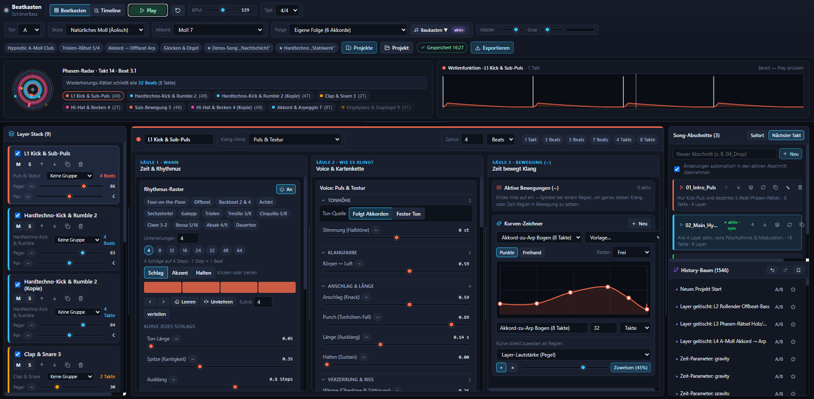
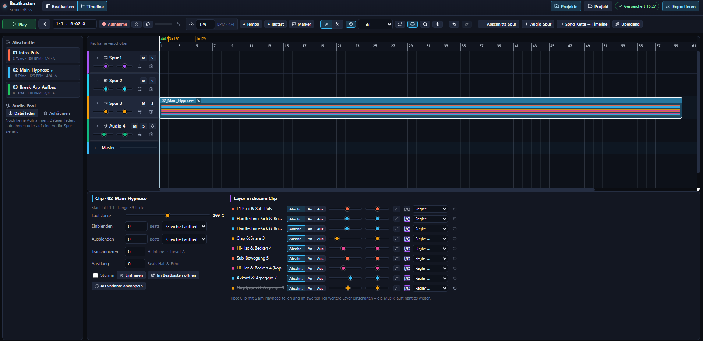

Beatkasten: 

Beats bauen aus beliebig langen Loops mit handlichen Bedienelementen, vor allem zugeschnitten auf Musiker mit Musiktheorieverständnis aber ohne Vorkenntnisse in Produktion am PC.
Sounds werden komplett in der Engine erzeugt.
Für mich ging es vorallem darum, Beats erzeugen zu können ohne mich in komplexe Software und Sound Engeneering Vokabular einarbeiten zu müssen. 

Zwei Workspaces, zwischen denen man oben hin und her schaltet:

- **Beatkasten:** die einzelnen Abschnitte als Loop bauen. Es gibt einen ziemlich umfangreichen Akkordbaukasten in dem man quasi jede Kadenz erzeugen kann. 

  

- **Timeline:** die Abschnitte zu einem ganzen Song anordnen, mit Keyframes, Übergängen und Effekten. Dazu Audio-Spuren für eigene Dateien, Aufnahme direkt im Programm (Metronom, Vorzähler, Takes) und ein Sample-Instrument, mit dem sich jede Aufnahme spielen lässt. Export als WAV/MP3, auch als Einzelspuren.

  

Es ist sehr simpel neue Instrumente und Effekte hinzuzufügen von der Code Architektur, ich freu mich über jede Erweiterung.

Lizenz: [MIT](LICENSE)
